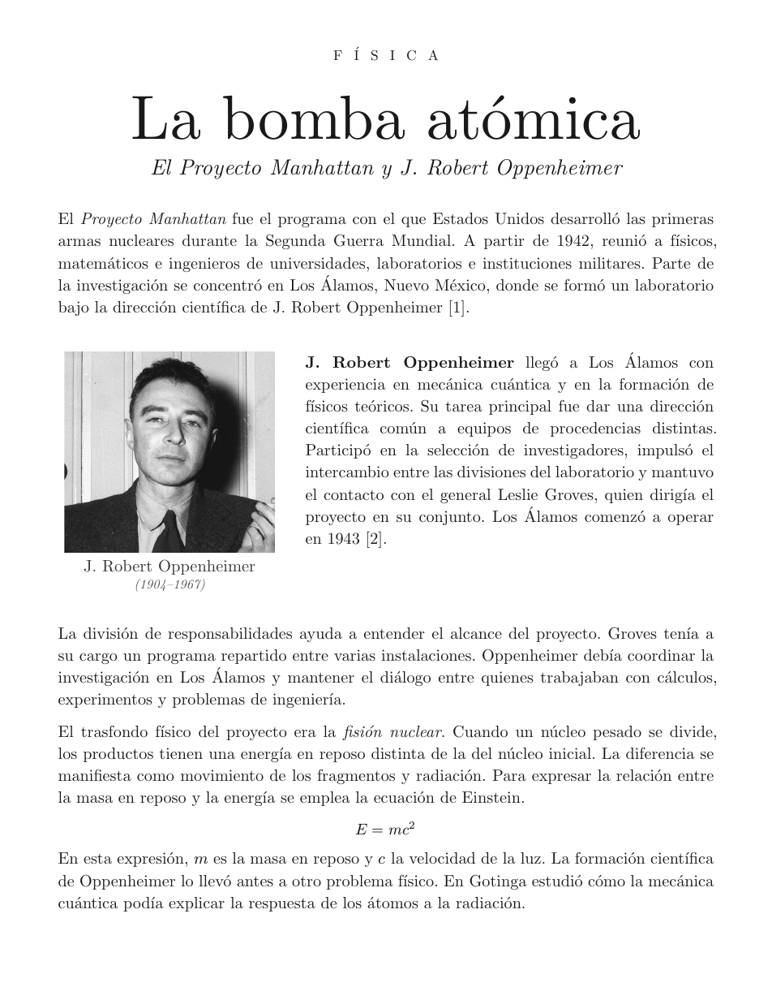
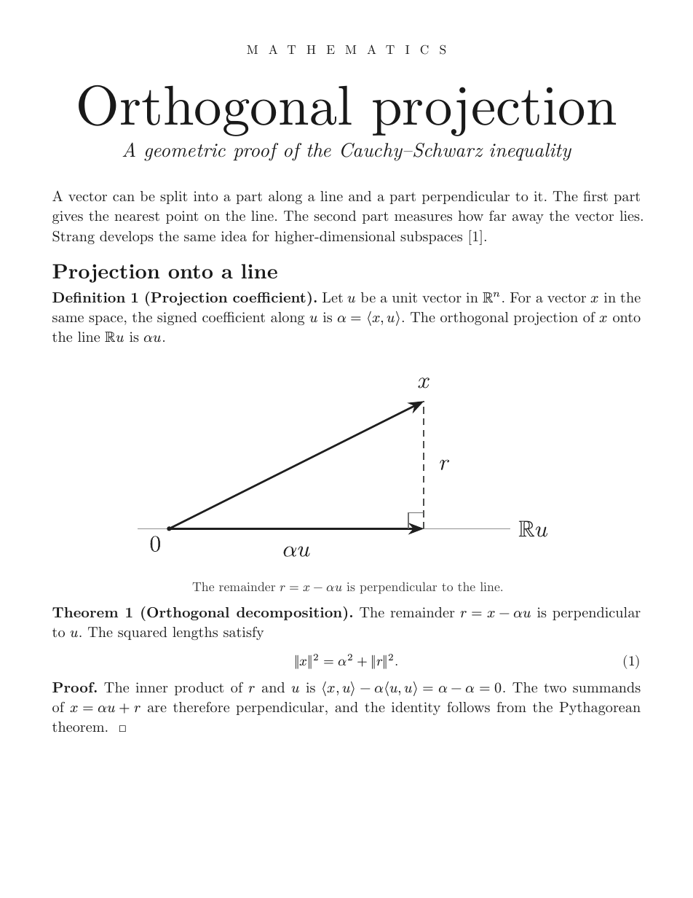
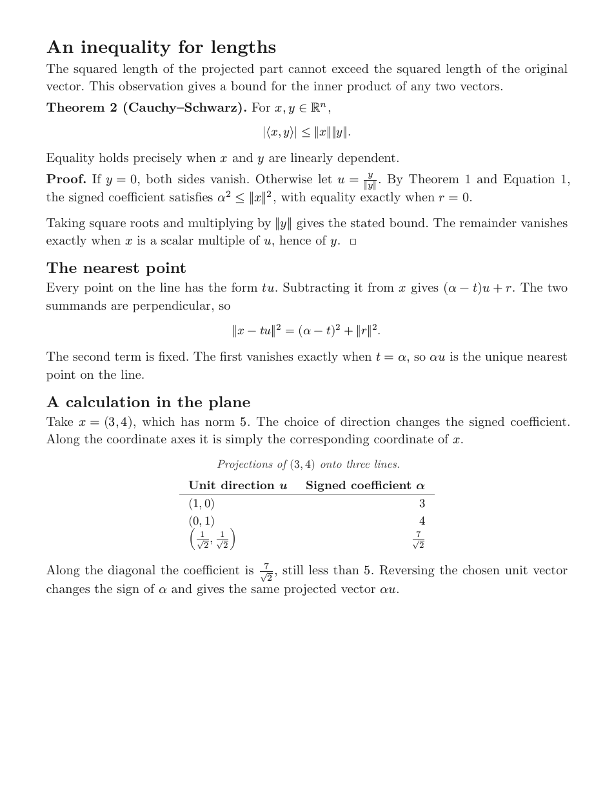
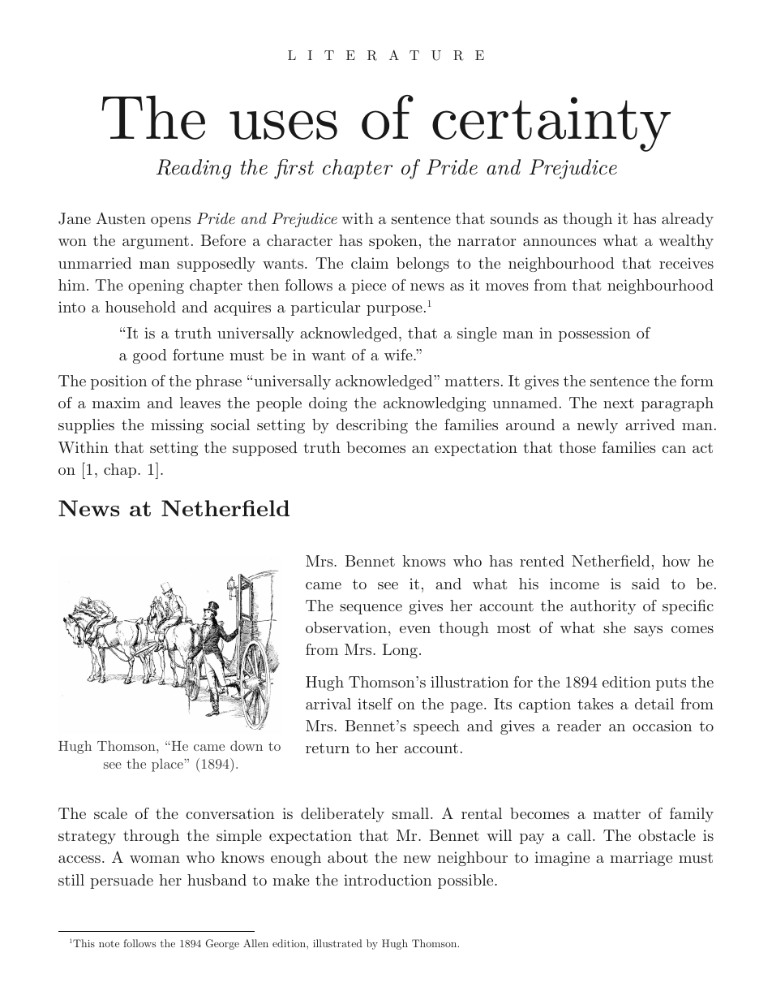
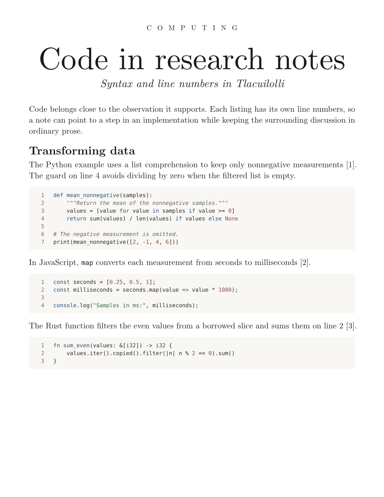
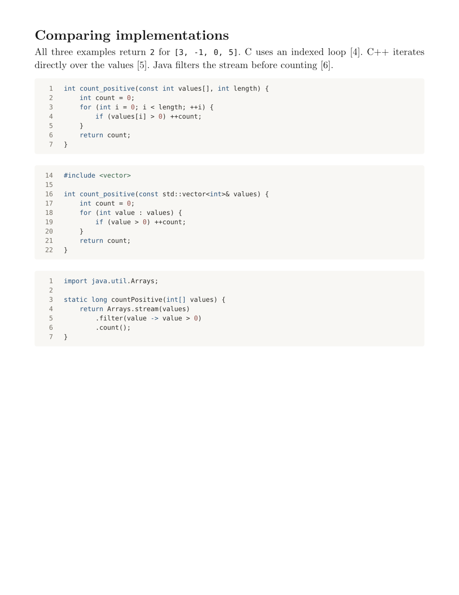

# Tlacuilolli

Tlacuilolli is a Typst library for research notes and scholarly essays. It starts with a centered title and justified serif prose on US Letter or A4. Photographs, equations, quotations, and tables sit in the running text. The same package supports English and Spanish documents.

The project takes its name from the Nahuatl word `tlacuilolli`, recorded in the Gran Diccionario Náhuatl as “escritura, pintura.” [Dictionary entry at UNAM](https://tlachia.iib.unam.mx/elementos/tlacuilolli)

## Quick start

### Typst web app

1. Download and unzip the source archive from [Tlacuilolli v0.3.0](https://github.com/MHAlberto/Tlacuilolli/releases/tag/v0.3.0).
2. Create a blank project in [Typst](https://typst.app/). Upload `lib.typ` next to `main.typ`. Create a `src` folder in the project and upload all the files from the archive's `src` folder into it.
3. Paste this into `main.typ`. Start writing below the show rule.

```typst
#import "lib.typ": note-document

#show: note-document.with(
  title: [Cuaderno de lectura],
  subtitle: [Notas sobre una primera edición],
  category: [Literatura],
  lang: "es",
)

Aquí comienza mi investigación.

$ a^2 + b^2 = c^2 $
```

To use helpers such as `theorem`, import them alongside `note-document` or use `: *` to import the full API.

### Add a code block

Use a fenced block with a language tag. Tlacuilolli adds syntax colors and line numbers automatically.

````typst
```python
def squared(x):
    return x * x

print(squared(4))
```
````

Use `cpp` for C++. See the [code example](examples/code.typ) for Python, JavaScript, Rust, C, C++, and Java, and the [API guide](docs/api.md#source-code) for titles and custom line numbers.

### Typst Universe

The [registry submission for `0.3.0`](https://github.com/typst/packages/pull/6394) is pending review. Once Typst Universe publishes it, you can start a web project with this import and the same basic show rule.

```typst
#import "@preview/tlacuilolli:0.3.0": note-document
```

### Typography

The default typeface is New Computer Modern, with Libertinus Serif as a fallback. Both ship with the official Typst CLI. Display equations are set at 95% of the surrounding text size. Use `equation-size` to adjust them and `title-font` to choose a separate face for the title. The [typography options](docs/api.md#typography) include serif pairings.

## Gallery

Each image opens at full size. The linked PDFs include the complete notes and their references.

| Physics | Mathematics |
| :---: | :---: |
| [](docs/previews/physics.png) | [](docs/previews/mathematics.png) |
| [Download PDF](https://github.com/MHAlberto/Tlacuilolli/releases/download/v0.3.0/atomic-bomb.pdf) · [Source](examples/atomic-bomb.typ) | [Download PDF](https://github.com/MHAlberto/Tlacuilolli/releases/download/v0.3.0/mathematics.pdf) · [Source](examples/mathematics.typ) |

| Equations and tables | Literature |
| :---: | :---: |
| [](docs/previews/equations-and-tables.png) | [](docs/previews/literature.png) |
| [Download PDF](https://github.com/MHAlberto/Tlacuilolli/releases/download/v0.3.0/mathematics.pdf) | [Download PDF](https://github.com/MHAlberto/Tlacuilolli/releases/download/v0.3.0/literature.pdf) · [Source](examples/literature.typ) |

| Python, JavaScript, and Rust | C, C++, and Java |
| :---: | :---: |
| [](docs/previews/code.png) | [](docs/previews/code-languages.png) |
| [Download PDF](https://github.com/MHAlberto/Tlacuilolli/releases/download/v0.3.0/code.pdf) · [Source](examples/code.typ) | [References page](docs/previews/code-references.png) |

## Install as a local package

Copy `lib.typ`, `typst.toml`, `LICENSE`, and `src/` into the version directory for your platform. Run the copy commands from the repository root.

| Platform | Version directory |
| --- | --- |
| Windows | `%APPDATA%\typst\packages\local\tlacuilolli\0.3.0` |
| Linux | `$XDG_DATA_HOME/typst/packages/local/tlacuilolli/0.3.0`, or `~/.local/share/typst/packages/local/tlacuilolli/0.3.0` |
| macOS | `~/Library/Application Support/typst/packages/local/tlacuilolli/0.3.0` |

```powershell
$tlacuilolliPackage = Join-Path $env:APPDATA 'typst\packages\local\tlacuilolli\0.3.0'
New-Item -ItemType Directory -Force -Path $tlacuilolliPackage | Out-Null
Copy-Item -Path lib.typ, typst.toml, LICENSE, src -Destination $tlacuilolliPackage -Recurse -Force
```

```sh
# Linux
tlacuilolli_package="${XDG_DATA_HOME:-$HOME/.local/share}/typst/packages/local/tlacuilolli/0.3.0"
# macOS uses the following path instead of the Linux assignment above.
# tlacuilolli_package="$HOME/Library/Application Support/typst/packages/local/tlacuilolli/0.3.0"
mkdir -p "$tlacuilolli_package"
cp lib.typ typst.toml LICENSE "$tlacuilolli_package/"
cp -R src "$tlacuilolli_package/"
```

In your own project, use the same show rule with this import.

```typst
#import "@local/tlacuilolli:0.3.0": *
```

During development, rerun the copy commands after edits. If a module is removed, remove the corresponding old file from the installed copy. On a version bump, install to a new version directory and update the import in the consuming document. Typst also accepts `--package-path` for a custom package root. See [Typst's local package instructions](https://github.com/typst/packages#local-packages).

## Public API

| Functions | Purpose |
| --- | --- |
| `note-document` | Page layout, type, title, and PDF metadata |
| `image-left`, `image-right`, `image-center` | Figures with optional captions |
| `display-equation` | Native display math with optional numbering and references |
| `code-listing` | Highlighted code with optional titles and configurable line numbers |
| `inner`, `set-builder`, `derivative`, `partial-derivative` | Mathematical notation |
| `theorem`, `definition`, `lemma`, `proposition`, `corollary`, `axiom`, `example`, `remark` | Bilingual statements with independent, document-wide counters |
| `proof` | Unnumbered proof with an optional closing mark |
| `roman-list`, `note-table` | Native enumerations and tables with restrained styling |

Side figures use two fixed columns. Long prose can continue in its column across pages, and the text after the macro resumes at full width. Use native `@key` citations and `#bibliography(...)` with your own `.bib` or Hayagriva file. The [API reference](docs/api.md) documents parameters, examples, and page-break behavior.

Tables size their columns to the contents by default. For a wider table, specify flexible tracks such as `columns: (2fr, 1fr)`.

## Development

The research notes and the code example share the US Letter layout, type sizes, and spacing.

From the repository root, run the test script with PowerShell 7.

```text
pwsh -NoProfile -File tests/run.ps1
```

The script builds the PDFs and PNG previews of the physics opening page and the code example under `build/`. It also checks document-wide counters, both languages, native references, figure geometry and pagination, repeating table headers, and a staged `@local` import. GitHub Actions runs the same script. To compile or preview an example directly, create the `build/` directory and run the following commands.

```sh
typst compile --root . examples/atomic-bomb.typ build/atomic-bomb.pdf
typst compile --root . --pages 1 --ppi 130 examples/atomic-bomb.typ build/atomic-bomb-preview.png
```

### Figures and image size

The [diagram sources](examples/diagrams/) are standalone LaTeX files. The examples embed vector PDF and SVG from `examples/assets/`. To regenerate a figure, run the [TikZ renderer](.agents/skills/tikz-diagrams/scripts/render_diagram.py) with Tectonic on PATH. SVG export also uses PyMuPDF 1.x.

```sh
python .agents/skills/tikz-diagrams/scripts/render_diagram.py examples/diagrams/oppenheimer.tex examples/assets/oppenheimer.pdf
python .agents/skills/tikz-diagrams/scripts/render_diagram.py examples/diagrams/projection.tex examples/assets/projection.svg
```

The [image optimizer](.agents/skills/document-images/scripts/prepare_image.py) uses Pillow to size rasters by printed width and target DPI. The [image credits](examples/assets/CREDITS.md) record the source files and optimization settings. Building the examples from the supplied assets requires only Typst.

### Codex workflows

Open the repository in Codex to use [`$tikz-diagrams`](.agents/skills/tikz-diagrams/SKILL.md) for figures or [`$document-images`](.agents/skills/document-images/SKILL.md) for sourcing and compression. The repository also defines [`tikz_diagrammer`](.codex/agents/tikz_diagrammer.toml) and [`document_image_editor`](.codex/agents/document_image_editor.toml) for scoped delegation. [Codex skills documentation](https://learn.chatgpt.com/docs/build-skills) · [Custom subagents](https://learn.chatgpt.com/docs/agent-configuration/subagents)

## License and package name

The code and original diagrams use the [MIT license](LICENSE). Archival images have separate [credits and public-domain records](examples/assets/CREDITS.md).

See the [publishing guide](docs/publishing.md) for GitHub releases and Typst Universe submissions.
